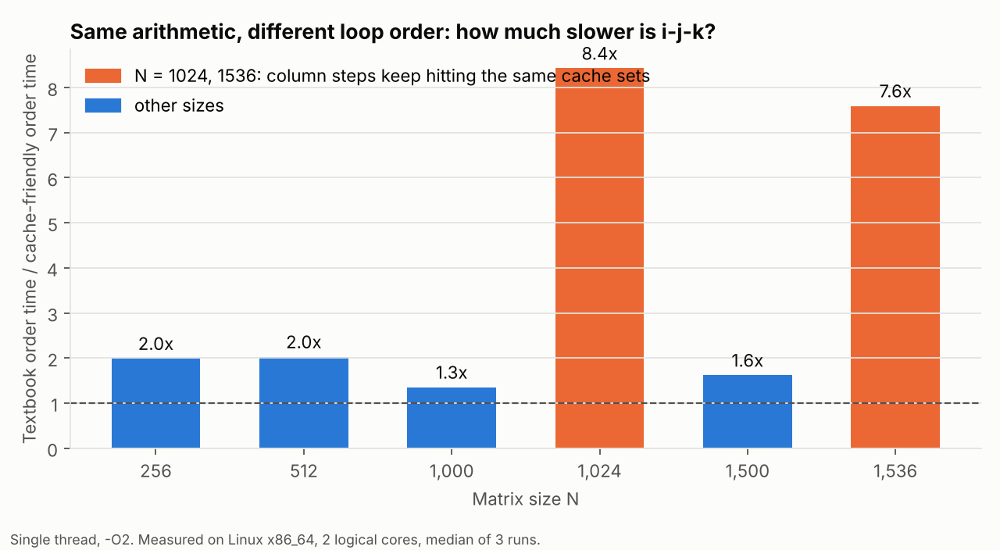
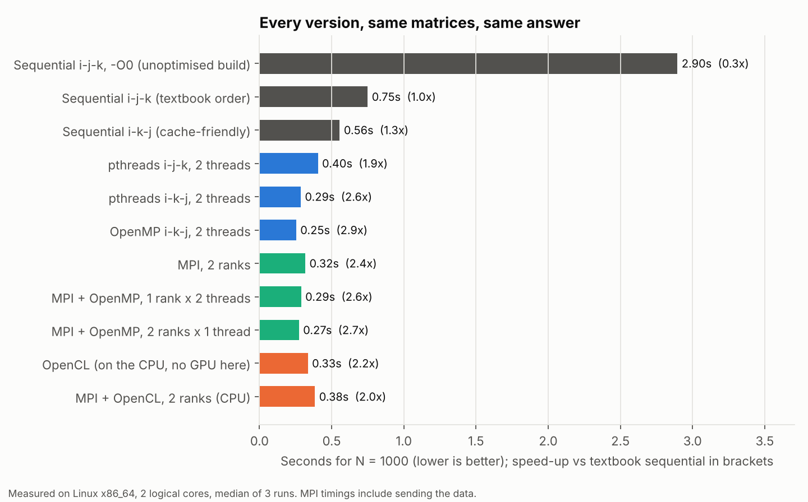

# Matrix multiplication: from one thread to MPI + OpenCL

`C = A x B` for N x N integer matrices, written seven ways:

| Program | Parallelism |
|---|---|
| `sequential` | none (baseline), with `--order ijk` (textbook) or `--order ikj` (cache-friendly) |
| `pthreads` | POSIX threads, one block of rows per thread |
| `openmp` | `#pragma omp parallel for` over rows |
| `mpi` | rows of A scattered across processes, B broadcast, rows of C gathered back |
| `mpi_openmp` | MPI between processes, OpenMP threads inside each |
| `opencl` | one OpenCL work-item per element of C (GPU if present, otherwise CPU) |
| `mpi_opencl` | MPI between processes, OpenCL inside each |

Every program multiplies the same seeded matrices. With `--verify`, each one recomputes the answer single-threaded and compares every element. [`tests/check.sh`](tests/check.sh) runs all seven on sizes that do and do not split evenly between threads and ranks (N = 1, 97, 256).

## Results

Median of 3 runs on a 2-core Linux machine with no GPU (OpenCL ran on the CPU through POCL).

### 1. Loop order matters more than you would think, and N = 1024 is a trap



The textbook loop computes each `C[i][j]` by walking along a row of A and **down a column** of B. Each step down a column jumps N integers in memory, so most reads of B miss the cache. Swapping the two inner loops (`i-k-j`) does exactly the same arithmetic but reads everything row by row.

How much this matters depends on N:

- For ordinary sizes (N = 1000, 1500), the cache-friendly order is **1.3x to 1.6x** faster.
- For **N = 1024 and 1536** it is **8.4x and 7.6x** faster. A column step of 1024 x 4 bytes = 4 KB is a multiple of the cache's set spacing, so consecutive column reads all compete for the same few cache sets and keep evicting each other.

I originally attributed the whole 8x at N = 1024 to loop order. Testing N = 1000 showed that most of it was this power-of-two effect. So the comparison below uses **N = 1000**, which is not a power of two.

### 2. Every version at N = 1000



- **Compiler optimisation first:** an unoptimised build (`-O0`) is 3.9x slower than `-O2` (2.90 s vs 0.75 s). Timing a `-O0` build makes any parallel version look better than it is.
- **Then the loop order:** 0.75 s to 0.56 s on one thread, for free.
- **Then threads:** 2 threads on the cache-friendly order reach 0.29 s (pthreads) and 0.25 s (OpenMP), about 2x the single-threaded `i-k-j`, which is about as far as 2 cores can go. In total, OpenMP is 2.9x faster than the textbook sequential version.
- **MPI** (0.32 s with 2 ranks) is slightly slower than threads, because the timing includes copying A and B to each process and C back.
- **Hybrids** (MPI + OpenMP) land at 0.27-0.29 s: with 2 cores, there is nothing more to gain by splitting them differently.
- **OpenCL on a CPU** (0.33 s) is competitive with 2 threads, but this machine has no GPU. On a laptop GPU the same kernel should be much faster. The timing includes copying the matrices to and from the device, not just the kernel.

### Bugs I fixed from my original coursework version

- **OpenMP was very likely off in the hybrid version.** My original MPI + OpenMP timing (about 1.2 s at N = 1000) was slower than plain sequential, which is what a single thread looks like. Without the `-fopenmp` compiler flag, `#pragma omp` is ignored with no error. I tested this: the same hybrid code ran at half speed without the flag. The OpenMP programs here refuse to compile without it (`#error` if `_OPENMP` is not defined).
- **OpenCL errors were ignored.** The MPI + OpenCL version set a 5th argument on a 4-argument kernel, which fails, but nothing checked the return code. Every OpenCL call now goes through `CL_CHECK`, and the kernel genuinely takes 5 arguments (`rows` lets each rank multiply only its block).
- **Unfair timings.** The OpenCL timer covered only the kernel, not the data copies, while the MPI + OpenCL timer included compiling the kernel. Now both report copy + compute as `seconds`, and setup/compilation separately as `setup_seconds`.
- **Results were never checked.** Now every version can verify itself, and the benchmark refuses to record a run whose checksum differs from the sequential one.
- **Uneven splits.** The pthreads version gave the remainder rows all to the last thread. Rows are now spread so no thread has more than one extra row, and the MPI versions use `Scatterv`/`Gatherv` for the same reason.

## Run it

```bash
make cpu          # sequential, pthreads, openmp (needs a compiler with OpenMP)
make mpi          # needs MPI
make opencl       # needs an OpenCL runtime and headers
make check        # build everything and verify every version

./bin/sequential --n 1000 --order ijk
./bin/openmp --n 1000 --threads 4 --verify
mpirun -n 4 ./bin/mpi_openmp --n 1500 --threads 2
python3 bench/run_benchmarks.py && python3 bench/make_charts.py
```

**macOS:** Apple's clang has no built-in OpenMP. Either use Homebrew GCC (`make CXX=g++-14`) or install `libomp` and pass `OMPFLAGS="-Xpreprocessor -fopenmp -lomp -I$(brew --prefix libomp)/include -L$(brew --prefix libomp)/lib"`. OpenCL is built into macOS.
**Ubuntu:** `sudo apt install libopenmpi-dev openmpi-bin opencl-headers ocl-icd-opencl-dev pocl-opencl-icd`.
