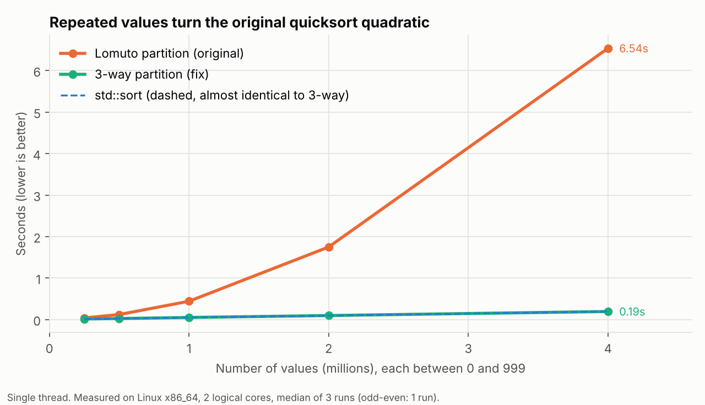
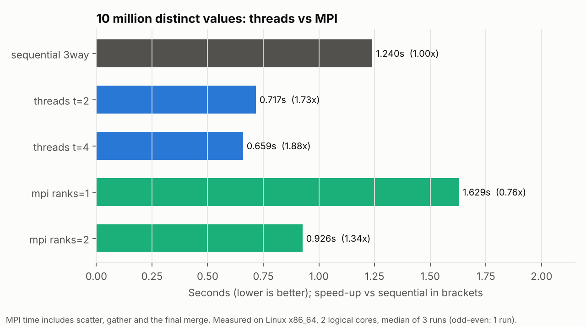
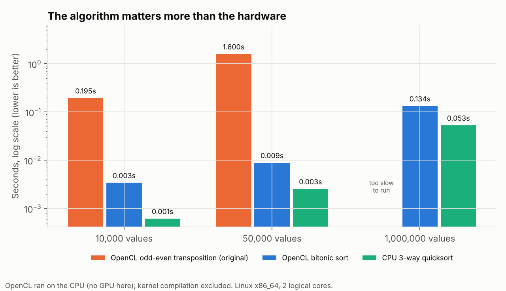

# Parallel sorting: quicksort with threads, MPI and OpenCL

| Program | What it does |
|---|---|
| `sequential` | one thread; `--algo lomuto` (my original partition), `3way` (the fix) or `std` (`std::sort`) |
| `threads` | 3-way quicksort where each partition step hands one half to a new `std::thread`, down to a depth limit |
| `mpi` | scatter chunks to processes, each sorts its chunk, gather, then a k-way heap merge on rank 0 |
| `mpi_opencl` | same, but each process sorts its chunk on an OpenCL device; `--kernel oddeven` (original) or `bitonic` |

Every program checks itself with `--verify`: the output must be identical to `std::sort` on the same input. [`tests/check.sh`](tests/check.sh) runs 46 cases, including an empty input, a single value, all-equal values, sizes that do not split evenly between ranks, and mostly distinct values.

## Results

Median of 3 runs on a 2-core Linux machine with no GPU (OpenCL ran on the CPU through POCL).

### 1. Repeated values made my original quicksort quadratic



The original assignment sorted random values between 0 and 999, so a million values contain each number about a thousand times. The Lomuto partition sends every value equal to the pivot to the same side. A block of equal values therefore only shrinks by one element per partition, and the sort degrades towards O(n²). Doubling the input roughly **quadruples** the time: 0.44 s for 1M values, 1.75 s for 2M, 6.54 s for 4M.

A **3-way partition** (values less than, equal to and greater than the pivot) finishes all copies of the pivot in one pass, so repeats make it faster instead of slower: **0.19 s for 4M values, 34x faster**, and level with `std::sort`.

On mostly distinct values the problem disappears (4M values: Lomuto 0.40 s, 3-way 0.47 s, `std::sort` 0.36 s). The 3-way version does a little extra comparing there, which is the price of being safe on repeated values.

This bug also made my original MPI results misleading. Smaller chunks contain fewer repeats, so splitting the data between processes made each piece disproportionately cheaper, and 1 to 2 processes showed a 3.6x speed-up on 2 cores.

### 2. Threads vs MPI on 10 million values



- **Threads:** 1.73x with 2 threads and 1.88x with 4. Four threads help a little even on 2 cores, because random pivots split the array unevenly, and more pieces even out the work.
- **MPI:** 1.34x with 2 processes. Even 1 process is slower than sequential (1.63 s vs 1.24 s), because the timing includes sending 40 MB to the workers, gathering it back and merging. Threads share memory, so they pay none of that. MPI earns its cost when the data does not fit on one machine.

### 3. On OpenCL, the algorithm matters more than the hardware



My original OpenCL version used **odd-even transposition sort**. Each pass is fully parallel, but it needs as many passes as there are values, so the total work is O(n²) however many processors share each pass. 50,000 values took **1.6 s** (my original report measured 1.67 s on a laptop). **Bitonic sort**, the standard GPU sorting network, does O(n log² n) work and sorted the same 50,000 values in **0.009 s, about 180x faster**. Odd-even was too slow to run at 1M values.

On this machine's CPU, plain quicksort is still faster than bitonic (0.053 s vs 0.134 s for 1M values). A real GPU changes that comparison, which is why bitonic sort is the standard choice there.

## What I fixed from my original coursework versions

| Original | Problem | Now |
|---|---|---|
| `MPI_Scatter` with `chunk = N / size` | Silently dropped the last `N % size` values. With 3 processes and 1,000,000 values, the output had 999,999 values but still printed "Sorted 1000000 elements". | `MPI_Scatterv` with counts spread so no rank has more than one extra value |
| Rank 0 re-sorted the whole gathered array with `std::sort` in the OpenCL version | The result was sorted even if the OpenCL kernel did nothing, so the parallel step was never actually tested, and the timing included a full single-threaded sort | k-way heap merge of the sorted chunks, plus `--verify` |
| Timer stopped before the final merge (MPI version) | The slowest step was not counted | Timer covers scatter, sort, gather and merge |
| Merge scanned every chunk for each output value, O(N k) | Gets slower with more processes | Min-heap merge, O(N log k) |
| Lomuto partition on data with many repeats | Quadratic (see above) | 3-way partition |
| Speed-up claimed from a single run of a 3 ms sort, built without optimisation | Noise as large as the effect | Median of several runs, `-O2`, sizes up to 10M |
| Docker image ran the "hybrid" with `-np 1`, and the MPI and OpenCL builds used different optimisation levels | The hybrid numbers had no distribution, and the comparison was unfair | Same flags everywhere, rank counts in the benchmark |
| No OpenCL error checks | Failures were silent | Every call checked (`CL_CHECK`) |

## Run it

```bash
make cpu          # sequential, threads
make mpi          # needs MPI
make opencl       # needs an OpenCL runtime and headers
make check        # build everything and run the 46 verification cases

./bin/sequential --n 4000000 --range 1000 --algo lomuto     # watch it struggle
./bin/sequential --n 4000000 --range 1000 --algo 3way
./bin/threads --n 10000000 --range 2000000000 --threads 4 --verify
mpirun -n 4 ./bin/mpi --n 10000000 --verify
mpirun -n 2 ./bin/mpi_opencl --n 1000000 --kernel bitonic --verify
python3 bench/run_benchmarks.py && python3 bench/make_charts.py
```

Requirements are the same as for the matrix project (see the top-level README).
