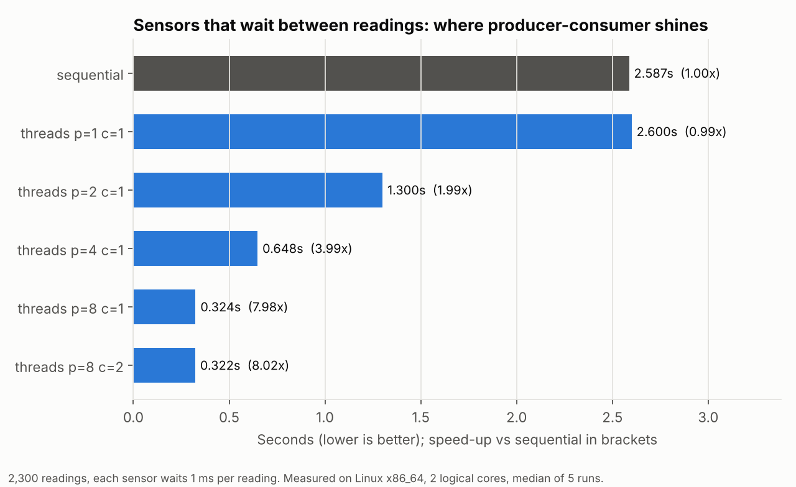
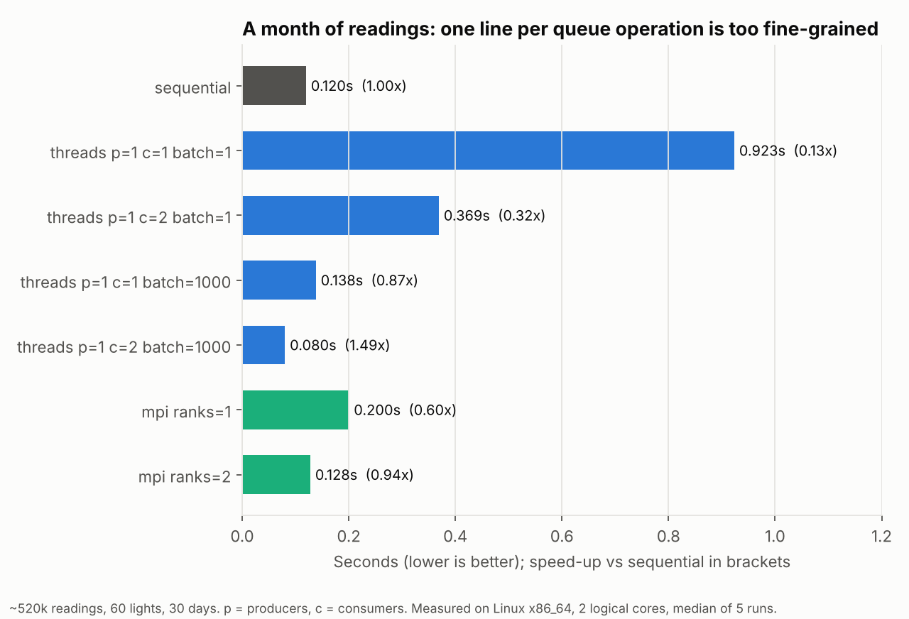

# Traffic control simulator: producer-consumer threads and MPI

Traffic lights report how many cars passed every 5 minutes. The simulator finds the **top N most congested lights for every hour**.

| Program | How it works |
|---|---|
| `sequential` | read, parse and add up in one thread |
| `threads` | any number of **producer** threads (sensors) push readings into a **bounded queue**; any number of **consumer** threads parse and aggregate them |
| `mpi` | rank 0 reads the file and scatters blocks of lines; every rank aggregates its block; rank 0 gathers and merges the partial counts |

Input lines look like `2025-03-01 16:05,TL07,184`. [`tests/generate_data.py`](tests/generate_data.py) creates realistic files: rush-hour peaks, a different base level per light and a few malformed lines. [`data/sample.csv`](data/sample.csv) is one day for 8 lights.

```
$ ./bin/sequential --top 3
2025-03-01 16:00 TL02=2354, TL03=2155, TL08=2140
2025-03-01 17:00 TL02=2408, TL03=2187, TL08=2127
...
```

[`tests/check.sh`](tests/check.sh) checks that every version prints exactly the same report as the sequential one. It covers 1-4 producers, 1-4 consumers, several batch sizes and 1, 2 and 5 MPI ranks, on the sample and on a week of data for 25 lights. It also checks that hours stay in time order across midnight.

## Design

- **Bounded queue** ([`include/bounded_queue.hpp`](include/bounded_queue.hpp)): a mutex and two condition variables. Producers block when it is full and consumers block when it is empty. It is closed only after **all** producers finish. My original version used a single `finished` flag, which works with one producer but would make consumers quit early as soon as the first of several producers finished.
- **No lock in the hot loop:** each consumer aggregates into its own private counts and merges once at the end.
- **Batching** (`--batch N`): a queue item is a range of N lines rather than one line (see results).
- **MPI messages sized at run time:** byte counts are scattered/gathered first, then the data (`MPI_Scatterv` / `MPI_Gatherv`). Rank 0 also processes a block itself, and any number of ranks works, including 1.
- **Hours in time order:** keys are `YYYY-MM-DD HH`, which sort correctly as text, including past midnight and across days.

## Results

Median of 5 runs on a 2-core Linux machine.

### 1. Real-time sensors: where producer-consumer shines



Real sensors produce a reading and then wait. With each sensor waiting 1 ms per reading, one thread spends almost all its time waiting (2.59 s for 2,300 readings). Eight producer threads wait **at the same time**, giving **8.0x** on a 2-core machine, because waiting threads do not need a core. This is the problem the producer-consumer pattern is really designed for.

### 2. Crunching a stored file: the queue becomes the bottleneck



Parsing one line takes a fraction of a microsecond, which is less than pushing it through a mutex-protected queue. With one line per queue item, the threaded version is **7.7x slower** than sequential (0.92 s vs 0.12 s). Sending **1,000 lines per queue item** removes almost all of that overhead: 2 consumers then finish in **0.08 s, 1.5x faster than sequential**.

MPI on 2 ranks (0.13 s) only breaks even. Packing a month of readings into messages and sending them costs about as much as the parsing it saves. A distributed version pays off when the data is already spread across machines, which is the realistic case for traffic sensors around a city.

### What I fixed from my original coursework versions

| Original | Problem | Now |
|---|---|---|
| MPI master and workers received into a fixed `char buffer[4096]` | Crashed with "Message truncated" on a realistic file. With a month of data, one rank's result message is **503 KB**, 123 times the buffer. | Sizes sent first, then data |
| Threaded version printed one grand total | The task was the top N **per hour** | Hourly report in both versions |
| One shared `finished` flag | Unsafe with more than one producer | Queue closed after all producers join |
| Hours stored as an integer 0-23 | Overnight data printed 0:00 before 16:00, and several days would be merged together | Date + hour keys |
| `sleep_for()` in producers and consumers, while the report called the threaded version faster | The threaded run was 3.1 s vs near-instant sequential, so the claim was the opposite of the measurement | Sensor waiting is an explicit option (`--sensor-delay-us`), measured separately from CPU work |
| MPI with 1 process printed an empty report and still said "Simulation complete" | Rank 0 only coordinated, so with no workers nothing was counted | Rank 0 also processes a block |
| Data file edited between runs, so the report's numbers could not be reproduced | Results could not be checked | Generated, seeded data and a cross-version test |
| Consumers printed without a lock | Lines from different threads could interleave | Only the main thread prints |
| `std::stoi` with only `invalid_argument` caught | A huge number would crash the program | Both exceptions caught; malformed lines are counted and skipped |

## Run it

```bash
make              # sequential, threads, mpi
make check        # every version must print the same report
make data         # generate data/month.csv (~520k readings) for benchmarking

./bin/threads --producers 4 --consumers 2 --top 5
./bin/threads --file data/month.csv --quiet --consumers 2 --batch 1000
./bin/threads --producers 8 --sensor-delay-us 1000 --quiet
mpirun -n 4 ./bin/mpi --file data/month.csv --quiet
python3 bench/run_benchmarks.py && python3 bench/make_charts.py
```
